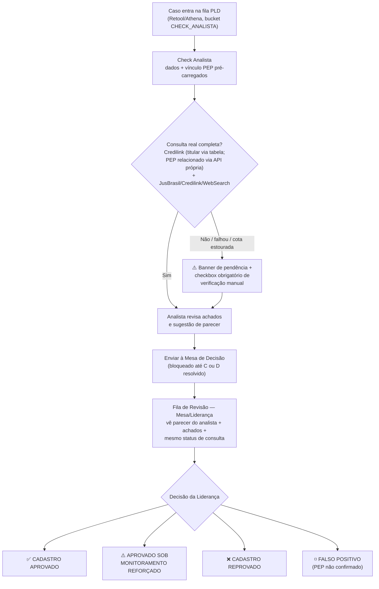

# Pepito — Apoio à Análise PLD/KYC de PEPs

**Pepito** é uma ferramenta interna construída para dar celeridade ao time de PLD/FT da Cora na
análise de cadastros com suspeita de Pessoa Politicamente Exposta (PEP), seguindo o fluxo de duas
camadas exigido pela Circular BCB nº 4.001/2020.

> ⚠️ **Pepito não é uma ferramenta implementada em produção pela Cora.** É um apoio interno do time
> de PLD/FT — a decisão final e a responsabilidade regulatória permanecem com os analistas e a
> Liderança de Compliance.
>
> **Acesso:** `https://192-168-201-67.sslip.io:4173` (VPN Cora) — único servidor, não subir instância paralela.

---

## O que o Pepito faz

Para cada cadastro suspeito de PEP na fila (vindo do Retool/Athena), o Pepito:

1. Pré-carrega os dados do cadastro e do vínculo PEP (Credilink).
2. Roda (ou expõe o status de) verificações reais — Credilink, JusBrasil, Credilink, mídia — para
   o titular da conta **e** para o PEP relacionado, quando aplicável.
3. Sugere um parecer (analista e, depois, Liderança), sempre editável.
4. **Bloqueia o envio à Mesa de Decisão se essas verificações não estiverem completas**, a menos que
   o analista confirme manualmente que verificou por fora.
5. Dá à Liderança os mesmos achados + o parecer do analista, para a decisão final em uma de 4
   categorias regulamentares.

Nada disso substitui o julgamento do analista/Liderança — é apoio à decisão, não decisão automática.

---

## Fluxo do processo



**Onde cada verificação acontece:**

| Verificação | Fonte | Quando roda | Owner do dado |
|---|---|---|---|
| Identificação do PEP | Credilink (via notebook do onboarding, fora deste repo) | Antes do caso chegar ao Pepito | `pep_pf` / `token_pf_cred` |
| Antecedentes do titular da conta | JusBrasil + Credilink | `fetch-media-findings.py`, disparado por `queue-sync.sh` | `media-findings.json` |
| Antecedentes do PEP relacionado | JusBrasil + Credilink (mesmo script, mesmo CPF do PEP) | idem | `media-findings.json` |
| Consulta Credilink do PEP relacionado (nunca existia antes de 2026-09-11) | `consultar-credilink-pep.py` | Manual/agendado, separado do fluxo de onboarding | `credilink-pep-consultas.json` |
| Mídia adversa (WebSearch) | Anthropic web_search | idem `fetch-media-findings.py` | `media-findings.json` |

---

## As duas camadas

### 1. CHECK_ANALISTA — `/check-analista`

- Fila com `bucket = CHECK_ANALISTA` do snapshot Retool/Athena.
- Card de cada caso mostra logo no topo o status de consulta Credilink e JusBrasil/Credilink
  (✅ OK / ⚠️ pendente, com o motivo).
- Analista abre o caso (`/primeira-camada`), revisa achados reais e a sugestão de parecer
  (LLM ou heurística), edita, e envia à Mesa.
- **Guardrail:** se Credilink (do PEP relacionado) ou JusBrasil/Credilink não tiverem consulta real
  registrada, o botão "Enviar à Mesa" fica bloqueado até o analista marcar o checkbox de
  "verifiquei manualmente" — essa confirmação fica registrada no histórico do caso (quem, quando,
  o que estava pendente).
- Pesquisa/Repesquisa manual (`pesquisarFontesPublicas`, simulação determinística) é desabilitada
  para casos reais, para nunca sobrescrever achado real com dado fictício — só existe no fluxo
  100% manual (Novo Caso Manual), sempre com aviso explícito de que é simulação.

### 2. CHECK_LIDERANÇA — `/fila-revisao` (Mesa de Decisão)

- Mesmo card de status Credilink/JusBrasil, mesmo parecer do analista, mesmos achados —
  a Liderança nunca reconsulta o que o Analista já verificou (mesmo draft_id).
- Decisão final em uma das 4 categorias: **APROVADO**, **REPROVADO**, **APROVADO SOB
  MONITORAMENTO REFORÇADO**, **FALSO POSITIVO**.
- Template de parecer final confere os achados reais antes de afirmar "ausência total de
  sanções/processos/mídia" — nunca afirma isso incondicionalmente só pela categoria escolhida.

### 3. Dashboard — `/dashboard`

KPIs operacionais (total, concluídas, tempo médio por camada, distribuição por status,
análises por analista) e exportação CSV. Não participa da decisão regulatória.

---

## Guardrails (o que impede um caso mal-verificado de avançar)

| Guardrail | Onde | Efeito |
|---|---|---|
| Filtros de elegibilidade da fila | `passesPLDFilters()` (`registration-queue.ts`) | Só entram casos com status/sub_status/person_type corretos |
| **Consulta real antes da Mesa** | `getConsultaStatus()` (`registration-enrich.ts`) + banner/checkbox em `AnalisePrimeiraCamada.tsx` | Bloqueia "Enviar à Mesa" sem consulta real ou confirmação manual explícita e auditável |
| Token Credilink rotulado corretamente | `AnalisePrimeiraCamada.tsx`, `NovaAnalise.tsx` | Nunca mostra o token do titular como se fosse do PEP relacionado |
| Simulação nunca sobrescreve dado real | `AnalisePrimeiraCamada.tsx`, `NovaAnalise.tsx` | "Pesquisar"/"Repesquisar" desabilitados para casos com `draft_id` real |
| Achado não-verificado nunca vira "confirmado" | `toResultado()` (`registration-enrich.ts`) | Deep-link nunca aberto = `pendente_verificacao: true`, sem badge de similaridade |
| Falha de API ≠ resultado negativo | `fetch-media-findings.py` (`_finding_erro_consulta`) | Erro técnico vira achado explícito "verificação manual necessária", nunca "nada encontrado" |
| Parecer final confere achados reais | `parecer.ts` (`corpoTemplate`) | Não afirma "ausência total" se há achado real não descartado |
| Match anti-homônimo | `passesPLDFilters` + telas de resultado | Só CNPJ/CPF idêntico conta como match; fuzzy por nome não reprova ninguém |
| Sugestão IA nunca diverge do parecer do analista | `getSugestaoParecer`/`getSugestaoLideranca` | Mesa sempre lê o comentário real do analista, nunca só o status sugerido |
| Persistência com fallback | `storage.ts` | `localStorage` + backup em `analises-salvas.json`; reload não perde dado |

**Limitação conhecida (não é bug, é contrato):** o JusBrasil Background Check só cobre processos
criminais, BNMP e MP — não tem endpoint cível/trabalhista. Para isso, o Credilink
(`ProcessoTribunalJustica`) complementa com achados não-criminais.

Detalhes de incidentes específicos (causa raiz, quando, como foi corrigido): ver
`.tools/INCIDENT-REPORT-*.md`.

---

## Stack

| Camada | Tecnologia |
|---|---|
| Frontend | React 18 + TypeScript + Vite |
| Servidor | Express (Node.js) — `server.cjs` |
| Autenticação | Google SSO (`@cora.com.br`) |
| Persistência | `localStorage` + `src/data/*.json` (backup em disco, sem banco externo) |
| Fonte de dados | Snapshot JSON da fila PLD (Retool/Athena) + consultas próprias (JusBrasil/Credilink) |

---

## Rodando localmente

```bash
# Dev (sem SSO, sem HTTPS)
npm install && npm run dev        # http://localhost:5173

# Produção local (SSO + HTTPS via certs/)
./start-local.sh
```

O binário portável do Node está em `.tools/node/bin/` — não precisa instalar Node no sistema
(`export PATH=".tools/node/bin:$PATH"`).

---

## Instalação em outra máquina

O Pepito não roda de um servidor central — hoje ele vive inteiramente numa única máquina (launchd
local + cron local). Isto significa que, sem este passo a passo, o app fica "preso" ao computador
de quem o configurou originalmente. Útil para migrar de máquina ou para um colega cobrir durante
férias/ausência.

### 1. Pré-requisitos de acesso

- Conta `@cora.com.br` com acesso aos dois repositórios GitHub (`origin` = pessoal, `corabank` =
  interno — ver seção seguinte).
- Acesso ao `.env` compartilhado da Thay (raiz de `Projetos Thay/`, fora deste repo) ou às
  credenciais equivalentes de cada serviço — peça ao time de PLD.
- Credenciais AWS (Coralago/Athena) válidas. **Atenção**: `.tools/queue-sync.sh` exige as variáveis
  `AWS_ACCESS_KEY_ID`/`AWS_SECRET_ACCESS_KEY`/`AWS_SESSION_TOKEN` **literalmente preenchidas no
  `.env` raiz** — ele não lê o cache de um `aws sso login` nem um profile do AWS CLI. Gere/renove
  essas três variáveis (via `aws sso login` + exportar as credenciais temporárias geradas, ou via
  DAM) e cole os valores no `.env`, não apenas rode o login isolado (ver
  `reference_aws_credenciais_temporarias_coralago_expiram` se você tiver acesso à memória do
  projeto).
- Conta Google (ChatGPT) própria ou compartilhada para autenticar o Codex CLI (ver passo 6).

### 2. Clonar os dois remotes

Este repositório é espelhado em dois remotes que **devem ficar idênticos** a cada commit:

```bash
git clone https://github.com/thay-cintra/pepito-frontend.git
cd pepito-frontend
git remote add corabank https://github.com/corabank/front-pepito.git
git fetch corabank
```

`origin` é o remote pessoal (GitHub da Thay); `corabank` é o remote interno da organização. Depois
de qualquer commit, confirme que os dois apontam pro mesmo SHA:

```bash
git push origin main && git push corabank main
git rev-parse origin/main corabank/main main   # os três hashes devem ser iguais
```

### 3. Node e Python

- **Node**: não precisa instalar nada — há um binário portável vendorizado em `.tools/node/bin/`.
  Exporte o PATH antes de rodar qualquer `npm`/`node` (já feito automaticamente por
  `start-local.sh` e pelos scripts em `.tools/`):
  ```bash
  export PATH="$(pwd)/.tools/node/bin:$PATH"
  npm install
  ```
- **Python**: os scripts de automação (`.tools/*.py`) rodam contra um `.venv` compartilhado **um
  nível acima** deste repo, em `Projetos Thay/.venv`. Se ele não existir na máquina nova:
  ```bash
  cd ..   # volta para Projetos Thay/
  python3 -m venv .venv
  source .venv/bin/activate
  pip install -r pepito-frontend/.tools/requirements.txt   # se existir; senão instalar manualmente:
  pip install boto3 awswrangler python-dotenv requests
  cd pepito-frontend   # volta pra este repo antes de seguir pro passo 4
  ```
  (confira `coralago/` — o pacote de acesso ao Lake usado pelos scripts — se ele também precisa ser
  instalado/clonado separadamente na máquina nova).
- **Caminhos nos scripts de automação**: `.tools/queue-sync.sh`, `full-guard-schedule.sh`,
  `supervisor-schedule.sh`, `refresh-daily.sh` e `athena-sync-guardrail.sh` calculam `ROOT`
  automaticamente a partir da própria localização do script (`$(cd "$(dirname "${BASH_SOURCE[0]}")/../.." && pwd)`)
  — não precisa editar nada, desde que o clone mantenha o nome de pasta padrão `pepito-frontend`
  (o nome que o `git clone` do passo 2 já usa por padrão), qualquer que seja o nome da pasta-pai;
  os scripts referenciam `<pasta-pai>/pepito-frontend/...` internamente.

### 4. Variáveis de ambiente (`.env`)

Há **dois arquivos `.env` diferentes**, e os dois são necessários:

| Arquivo | Para quê | Template |
|---|---|---|
| `Projetos Thay/.env` (raiz, fora deste repo) | Credenciais compartilhadas entre sub-projetos: AWS/Coralago, LiteLLM, Credilink, JusBrasil, PH3A, Slack | não versionado — copiar de outra máquina/cofre de credenciais |
| `pepito-frontend/.env` (dentro deste repo) | Config específica do servidor Pepito: Google OAuth, JWT, porta | `.env.example` já existe neste repo — copie e preencha |

```bash
cp .env.example .env   # dentro de pepito-frontend/
```

Preencha `pepito-frontend/.env` com: `APP_URL` (inclua a porta, ex.
`https://192-168-201-67.sslip.io:4173` — precisa bater exatamente com o hostname do certificado em
`certs/` e com o redirect URI cadastrado no Google, ver passo 7), `PORT`,
`GOOGLE_CLIENT_ID`/`GOOGLE_CLIENT_SECRET` (ver passo 7 — SSO), `JWT_SECRET` (gere com
`node -e "console.log(require('crypto').randomBytes(48).toString('hex'))"`) e `VITE_SSO_ATIVO`.
`LOCAL_MODE=true` pula o SSO (qualquer acesso autenticado passa) — o servidor escuta em `0.0.0.0`
sem nenhum filtro de rede próprio (a variável `VPN_ALLOWED_CIDRS` que aparecia aqui **não é lida em
nenhum lugar do código** — não confiar nela como controle de acesso); use esse modo só dentro de uma
VPN/rede que já restrinja o acesso externamente (firewall/roteamento), nunca como única barreira.

No `.env` raiz compartilhado, **nunca reaproveite um nome de variável genérico** (`API_KEY`,
`SLACK_WEBHOOK_URL` puro) — o `dotenv` mantém só a última ocorrência de uma chave duplicada e um
serviço "some" silenciosamente. Use sempre a variável dedicada e comentada de cada serviço:
`CREDILINK_API_KEY`, `JUSBRASIL_API_KEY`/`JUSBRASIL_API_BASE`, `PH3A_API_KEY`, `LITELLM_API_KEY`/
`LITELLM_BASE_URL`, `GOOGLE_SERVICE_ACCOUNT_JSON`, `SLACK_WEBHOOK_URL_PEPITO_SUPERVISOR`,
`SLACK_WEBHOOK_URL_PEPITO_INTEGRITY`, além das credenciais AWS (`AWS_ACCESS_KEY_ID`,
`AWS_SECRET_ACCESS_KEY`, `AWS_SESSION_TOKEN`, `AWS_DEFAULT_REGION`, `ATHENA_WORKGROUP`,
`CORA_ATHENA_OUTPUT`).

**Atenção de segurança**: `.tools/queue-sync.sh` faz `eval` em linhas selecionadas do `.env` raiz
para exportá-las. Só use um `.env` vindo de um cofre de credenciais confiável/da própria Thay —
nunca copie ou edite esse arquivo a partir de uma fonte não verificada, já que conteúdo malformado
nele pode executar comandos arbitrários com os privilégios de quem roda o pipeline.

### 5. Certificados HTTPS (`certs/`)

O modo "produção local" (`./start-local.sh` com SSO ativo) serve HTTPS com um certificado próprio
(gerado via [mkcert](https://github.com/FiloSottile/mkcert)), em `certs/cert.pem` + `certs/key.pem`
+ `certs/rootCA.pem`. Esse certificado é emitido para o hostname `sslip.io` que **codifica o IP
local da máquina original** (ex. `192-168-201-67.sslip.io` → `192.168.201.67`) — numa máquina nova,
com um IP de rede diferente, o certificado antigo **não vai bater** com o novo hostname. `certs/`
não é versionado no Git (não existe num clone novo) — gere um par próprio na máquina nova:

```bash
mkdir -p certs
brew install mkcert
mkcert -install                 # instala a rootCA local
# descubra o IP local (ex. via `ipconfig getifaddr en0`) e gere para o hostname sslip.io correspondente
mkcert -cert-file certs/cert.pem -key-file certs/key.pem <ip-com-tracos>.sslip.io localhost 127.0.0.1
cp "$(mkcert -CAROOT)/rootCA.pem" certs/rootCA.pem
```

O próprio servidor (`server.cjs`) serve uma página de instalação do `rootCA.pem` em
`http://<host>:<PORT+1>/` para quem for acessar de outro dispositivo na rede.

**Não copie `certs/key.pem` de outra máquina** — é a chave privada do certificado; reutilizá-la fora
da máquina onde foi gerada amplia a superfície de comprometimento sem necessidade. Gere um par novo
por máquina; distribua só a CA pública (`rootCA.pem`) quando precisar que outro dispositivo confie
no certificado.

Alternativa mais simples para cobertura temporária (ex. férias): rodar em `LOCAL_MODE=true` sem
HTTPS próprio, só dentro de uma rede já restrita por VPN/firewall — ver `start-local.sh` e o aviso
de segurança no passo 4 sobre `LOCAL_MODE`.

### 6. Codex CLI (fallback de IA quando o orçamento LiteLLM estoura)

Os geradores de parecer (`.tools/generate-sugestao-parecer.py` e
`.tools/generate-sugestao-lideranca.py`) usam Claude via proxy LiteLLM como caminho principal e
caem automaticamente para o Codex CLI quando o orçamento do proxy está esgotado. Isso depende de
uma instalação própria, independente do `.env`:

```bash
npm install -g @openai/codex
codex login          # autentica via conta ChatGPT (pode ser pessoal ou compartilhada pelo time)
```

Sem isso, o passo `[5/6]` do `queue-sync.sh` simplesmente não gera sugestão nenhuma quando o
LiteLLM estiver sem orçamento (falha isolada, registrada em `.tools/queue-sync.log`, não trava o
resto do pipeline).

### 7. Google SSO

Em produção (`VITE_SSO_ATIVO=true`, sem `LOCAL_MODE`), o login é feito via Google OAuth 2.0,
restrito ao domínio `@cora.com.br` (`SSO_DOMAIN`, default `cora.com.br`). Configure um projeto em
[console.cloud.google.com](https://console.cloud.google.com) (pode reusar o projeto já existente da
Cora, ou criar um novo "pepito-pld"): tipo **Web application**, com *Authorized redirect URI* igual
ao `APP_URL` do passo 4 + `/auth/google/callback` — ex. `https://192-168-201-67.sslip.io:4173/auth/google/callback`
(inclua a porta se `APP_URL` não for a 443; o hostname precisa ser exatamente o mesmo coberto pelo
certificado do passo 5). Preencha `GOOGLE_CLIENT_ID` e `GOOGLE_CLIENT_SECRET` no `.env` deste repo.

### 8. Subir o servidor como serviço (launchd)

Para o Pepito sobreviver a reboots e reiniciar sozinho se cair, instale-o como `launchd` agent
(equivalente a um serviço systemd no macOS). O plist **não é versionado neste repo** — crie
`~/Library/LaunchAgents/com.cora.pepito.server.plist` na máquina nova com este conteúdo, trocando
`/Users/<usuario>/Projetos Thay` pelo caminho real:

```xml
<?xml version="1.0" encoding="UTF-8"?>
<!DOCTYPE plist PUBLIC "-//Apple//DTD PLIST 1.0//EN" "http://www.apple.com/DTDs/PropertyList-1.0.dtd">
<plist version="1.0">
<dict>
  <key>Label</key>
  <string>com.cora.pepito.server</string>
  <key>ProgramArguments</key>
  <array>
    <string>/Users/<usuario>/Projetos Thay/pepito-frontend/.tools/node/bin/node</string>
    <string>server.cjs</string>
  </array>
  <key>WorkingDirectory</key>
  <string>/Users/<usuario>/Projetos Thay/pepito-frontend</string>
  <key>RunAtLoad</key>
  <true/>
  <key>KeepAlive</key>
  <dict>
    <key>SuccessfulExit</key>
    <false/>
    <key>Crashed</key>
    <true/>
  </dict>
  <key>StandardOutPath</key>
  <string>/Users/<usuario>/Projetos Thay/pepito-frontend/.tools/server.out.log</string>
  <key>StandardErrorPath</key>
  <string>/Users/<usuario>/Projetos Thay/pepito-frontend/.tools/server.log</string>
  <key>ThrottleInterval</key>
  <integer>5</integer>
</dict>
</plist>
```

Depois:

```bash
launchctl load ~/Library/LaunchAgents/com.cora.pepito.server.plist
launchctl kickstart -k gui/$(id -u)/com.cora.pepito.server
```

Logs ficam em `.tools/server.out.log` e `.tools/server.log`.

### 9. Agentes de monitoramento (cron)

O Supervisor Agent + Integrity Guard (ver seção seguinte) rodam 2x/dia via `crontab`, não launchd.
Adicione na máquina nova com `crontab -e`:

```cron
0 6  * * * cd /Users/<usuario>/Projetos\ Thay/pepito-frontend && NODE_ENV=development PYTHONUNBUFFERED=1 bash .tools/full-guard-schedule.sh >> .tools/full-guard.log 2>&1
0 14 * * * cd /Users/<usuario>/Projetos\ Thay/pepito-frontend && NODE_ENV=development PYTHONUNBUFFERED=1 bash .tools/full-guard-schedule.sh >> .tools/full-guard.log 2>&1
```

### 10. Verificando a instalação

1. `npm run typecheck` e `npm run build` sem erros.
2. `./start-local.sh` (ou `launchctl kickstart`) sobe o servidor — acesse pelo IP exibido no
   terminal.
3. Rode manualmente o Supervisor uma vez (`python3 .tools/supervisor-agent.py`) e confirme que ele
   consegue postar no Slack (`SLACK_WEBHOOK_URL_PEPITO_SUPERVISOR`).
4. Dispare "Sincronizar Athena" na interface (ou rode `.tools/queue-sync.sh` manualmente) e confirme
   no `.tools/queue-sync.log` que os passos `[0/3]` (credenciais AWS) e `[5/6]` (geração de
   sugestão IA, Claude ou Codex) terminam sem `[FATAL]`.
5. Depois de qualquer alteração de dado/código, lembre: **rebuild obrigatório** —
   `npm run build` + `launchctl kickstart -k gui/$(id -u)/com.cora.pepito.server` — os JSONs em
   `src/data/` são import estático, embutido no bundle em build-time; sem isso o app publicado
   continua servindo o snapshot antigo.

---

## Estrutura de arquivos relevantes

```
src/
  pages/
    CheckAnalista.tsx          — Fila CHECK_ANALISTA (1ª camada)
    AnalisePrimeiraCamada.tsx  — Formulário de análise, guardrail de consulta, cronômetro
    FilaRevisao.tsx            — Fila de revisão para Liderança
    NovaAnalise.tsx            — Mesa de Decisão (2ª camada)
    Dashboard.tsx              — Métricas e histórico
  components/
    RegistrationCaseCard.tsx   — Card da fila (Analista + Liderança) — status Credilink/JusBrasil no topo
  lib/
    registration-queue.ts      — Lógica de filas, buckets, synthesizeAnalise
    mock-ai.ts                 — SIMULAÇÃO determinística — só no fluxo 100% manual
  data/
    registration-enrich.ts     — getConsultaStatus(), enriquecimento de achados, pareceres
    registration-queue-real.json, media-findings.json, credilink-pep-consultas.json — dados

.tools/
  build-real-queue.py              — Puxa fila real do Athena
  fetch-media-findings.py          — JusBrasil + Credilink + WebSearch (owner + PEP relacionado)
  consultar-credilink-pep.py       — Consulta Credilink real do PEP relacionado (novo, 2026-09-11)
  generate-sugestao-parecer.py     — Sugestão IA (Analista)
  generate-sugestao-lideranca.py   — Sugestão IA (Liderança)
  generate-pld-risk-scores.py      — Score de risco
  queue-sync.sh                    — Pipeline disparado pelo botão "Sincronizar Athena"
  supervisor-agent.py              — Monitoramento automático (ver seção abaixo)
  integrity-guard.py                — Backup/auto-restore de pareceres
  INCIDENT-REPORT-*.md              — Histórico de incidentes com causa raiz e fix
```

---

## Monitoramento e proteção de dados

Dois agentes rodam automaticamente 2x/dia (6h e 14h), orquestrados por `full-guard-schedule.sh`:

- **Supervisor Agent** (`.tools/supervisor-agent.py`) — verifica servidor, fila, build, cobertura de
  sugestão IA, integridade dos JSONs e TypeScript. Alerta no Slack (`SLACK_WEBHOOK_URL_PEPITO_SUPERVISOR`)
  por nível de risco (🔴🟠🟡🔵).
- **Integrity Guard** (`.tools/integrity-guard.py`) — faz backup dos pareceres antes de cada janela,
  detecta exclusão/encolhimento e restaura automaticamente. Histórico em `.tools/backups/pareceres/`.

```bash
# Rodar manualmente
python3 .tools/supervisor-agent.py
python3 .tools/integrity-guard.py

# Ver logs
tail -f .tools/supervisor.log .tools/integrity.log
```

---

## Troubleshooting rápido

| Sintoma | Causa provável | Ação |
|---|---|---|
| Sugestão IA ausente para caso novo | `pareceres-*.json` regenerado mas app não rebuildado (import estático em build-time) | `npm run build` + reiniciar `com.cora.pepito.server` |
| "Credilink/JusBrasil: pendente" mesmo após rodar consulta | Servidor rodando bundle antigo | rebuild + `launchctl kickstart -k gui/$(id -u)/com.cora.pepito.server` |
| Draft some da fila | `camadaStatus` local desatualizado | ver `analises-salvas.json`, checar `devolvido`/`concluido` |
| Nenhum alerta no Slack | Webhook errado/ausente | `grep SLACK_WEBHOOK_URL_PEPITO_SUPERVISOR .env` |

---

**Última atualização:** 2026-10-22
