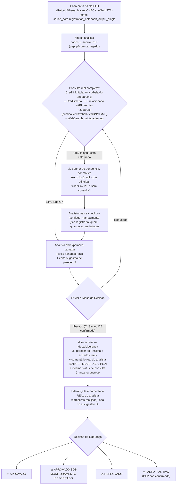
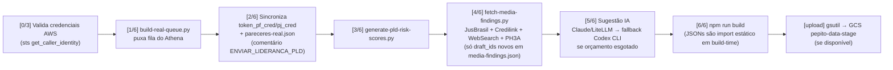

# Pepito — Apoio à Análise PLD/KYC de PEPs

**Pepito** é uma ferramenta interna construída para dar celeridade ao time de PLD/FT da Cora na
análise de cadastros com suspeita de Pessoa Politicamente Exposta (PEP), seguindo o fluxo de duas
camadas exigido pela Circular BCB nº 4.001/2020.

> ⚠️ **Pepito não é uma ferramenta implementada em produção pela Cora.** É um apoio interno do time
> de PLD/FT — a decisão final e a responsabilidade regulatória permanecem com os analistas e a
> Liderança de Compliance.
>
> **Acesso:** `https://192-168-201-67.sslip.io:4173` (VPN Cora) — único servidor, não subir instância paralela.
> Esse IP muda quando a VPN reconecta; se o navegador acusar "conexão não particular", ver
> [Certificado HTTPS quebra quando o IP da VPN muda](#certificado-https-quebra-quando-o-ip-da-vpn-muda).

---

## O que o Pepito faz

Para cada cadastro suspeito de PEP na fila (vindo do Retool/Athena), o Pepito:

1. Pré-carrega os dados do cadastro e do vínculo PEP (Credilink).
2. Roda (ou expõe o status de) verificações reais — Credilink, JusBrasil, Credilink, mídia — para
   o titular da conta **e** para o PEP relacionado, quando aplicável.
3. Sugere um parecer (analista e, depois, Liderança), sempre editável.
4. **Bloqueia o envio à Mesa de Decisão se essas verificações não estiverem completas**, a menos que
   o analista confirme manualmente que verificou por fora.
5. Dá à Liderança os mesmos achados + o parecer do analista, para a decisão final em uma de 4
   categorias regulamentares.

Nada disso substitui o julgamento do analista/Liderança — é apoio à decisão, não decisão automática.

---

## Fluxo do processo



**Onde cada verificação acontece (detalhado):**

| Verificação | Fonte real | Script/arquivo que roda | Quando | Dado final (owner) |
|---|---|---|---|---|
| Identificação do PEP | Credilink, via notebook do onboarding (fora deste repo) | — (já vem pronto no snapshot Athena) | Antes do caso chegar ao Pepito | campo `pep_pf` em `registration-queue-real.json` |
| Antecedentes do titular da conta | JusBrasil (5 endpoints) + Credilink/Tesserati | `fetch-media-findings.py`, chamado por `queue-sync.sh` passo `[4/6]` | A cada "Sincronizar Athena" (só casos novos, sem `--force`) | `media-findings.json` |
| Antecedentes do PEP relacionado | JusBrasil (mesmo CPF do PEP) + Credilink | idem, mesmo script | idem | `media-findings.json` |
| Consulta Credilink do PEP relacionado | Credilink/Tesserati | `consultar-credilink-pep.py` (não faz parte do `queue-sync.sh` — roda separado/manual) | Manual/agendado, fora do fluxo padrão de sincronização | `credilink-pep-consultas.json` |
| Mídia adversa / contratos públicos / Portal da Transparência | WebSearch (Anthropic, via proxy LiteLLM ou chave direta) | idem `fetch-media-findings.py` | idem | `media-findings.json` |
| Empresa em comum titular↔PEP sócio | PH3A (DataBusca) | idem `fetch-media-findings.py` | idem | `media-findings.json` |
| Sugestão de parecer (texto + decisão) | Claude via LiteLLM, com fallback Codex CLI | `generate-sugestao-parecer.py` / `generate-sugestao-lideranca.py`, passo `[5/6]` | idem | `pareceres-sugestao.json` / `pareceres-lideranca.json` |
| Score de risco PLD/FT | Heurística própria sobre os dados já coletados | `generate-pld-risk-scores.py`, passo `[3/6]` | idem | `pld-risk-scores.json` |

### Pipeline de sincronização (`queue-sync.sh`) — o que roda em cada passo



Qualquer passo `[1/6]`–`[5/6]` que falhe isoladamente **não aborta o pipeline inteiro** — os passos
seguintes ainda rodam (achado real: cada script grava um placeholder de "verificação manual
necessária" em vez de travar o lote). O passo `[6/6]` (rebuild) é o único que, se pulado, deixa
**todo** o trabalho dos passos anteriores invisível no app publicado (import estático em
build-time) — por isso ele nunca deve ser pulado manualmente.

---

## As duas camadas

### 1. CHECK_ANALISTA — `/check-analista`

- Fila com `bucket = CHECK_ANALISTA` do snapshot Retool/Athena.
- Card de cada caso mostra logo no topo o status de consulta Credilink e JusBrasil/Credilink
  (✅ OK / ⚠️ pendente, com o motivo).
- Analista abre o caso (`/primeira-camada`), revisa achados reais e a sugestão de parecer
  (LLM ou heurística), edita, e envia à Mesa.
- **Guardrail:** se Credilink (do PEP relacionado) ou JusBrasil/Credilink não tiverem consulta real
  registrada, o botão "Enviar à Mesa" fica bloqueado até o analista marcar o checkbox de
  "verifiquei manualmente" — essa confirmação fica registrada no histórico do caso (quem, quando,
  o que estava pendente).
- Pesquisa/Repesquisa manual (`pesquisarFontesPublicas`, simulação determinística) é desabilitada
  para casos reais, para nunca sobrescrever achado real com dado fictício — só existe no fluxo
  100% manual (Novo Caso Manual), sempre com aviso explícito de que é simulação.

### 2. CHECK_LIDERANÇA — `/fila-revisao` (Mesa de Decisão)

- Mesmo card de status Credilink/JusBrasil, mesmo parecer do analista, mesmos achados —
  a Liderança nunca reconsulta o que o Analista já verificou (mesmo draft_id).
- Decisão final em uma das 4 categorias: **APROVADO**, **REPROVADO**, **APROVADO SOB
  MONITORAMENTO REFORÇADO**, **FALSO POSITIVO**.
- Template de parecer final confere os achados reais antes de afirmar "ausência total de
  sanções/processos/mídia" — nunca afirma isso incondicionalmente só pela categoria escolhida.

### 3. Dashboard — `/dashboard`

KPIs operacionais (total, concluídas, tempo médio por camada, distribuição por status,
análises por analista) e exportação CSV. Não participa da decisão regulatória.

---

## Guardrails (o que impede um caso mal-verificado de avançar)

| Guardrail | Onde | Efeito |
|---|---|---|
| Filtros de elegibilidade da fila | `passesPLDFilters()` (`registration-queue.ts`) | Só entram casos com status/sub_status/person_type corretos |
| **Consulta real antes da Mesa** | `getConsultaStatus()` (`registration-enrich.ts`) + banner/checkbox em `AnalisePrimeiraCamada.tsx` | Bloqueia "Enviar à Mesa" sem consulta real ou confirmação manual explícita e auditável |
| Token Credilink rotulado corretamente | `AnalisePrimeiraCamada.tsx`, `NovaAnalise.tsx` | Nunca mostra o token do titular como se fosse do PEP relacionado |
| Simulação nunca sobrescreve dado real | `AnalisePrimeiraCamada.tsx`, `NovaAnalise.tsx` | "Pesquisar"/"Repesquisar" desabilitados para casos com `draft_id` real |
| Achado não-verificado nunca vira "confirmado" | `toResultado()` (`registration-enrich.ts`) | Deep-link nunca aberto = `pendente_verificacao: true`, sem badge de similaridade |
| Falha de API ≠ resultado negativo | `fetch-media-findings.py` (`_finding_erro_consulta`) | Erro técnico vira achado explícito "verificação manual necessária", nunca "nada encontrado" |
| Parecer final confere achados reais | `parecer.ts` (`corpoTemplate`) | Não afirma "ausência total" se há achado real não descartado |
| Match anti-homônimo | `passesPLDFilters` + telas de resultado | Só CNPJ/CPF idêntico conta como match; fuzzy por nome não reprova ninguém |
| Sugestão IA nunca diverge do parecer do analista | `getSugestaoParecer`/`getSugestaoLideranca` | Mesa sempre lê o comentário real do analista, nunca só o status sugerido |
| Persistência com fallback | `storage.ts` | `localStorage` + backup em `analises-salvas.json`; reload não perde dado |

**Atualizado em 2026-10-22:** o contrato JusBrasil Background Check cobre **todos os tipos de
processo** — criminal, civil e trabalhista, além de BNMP e MP — sem distinção/exclusão de
trabalhista (confirmado operacionalmente; os 5 endpoints já são consultados em
`fetch-media-findings.py::consultar_jusbrasil()`: `lawsuits/criminal`, `lawsuits/civil`,
`lawsuits/trabalhista`, `bnmp`, `mp`). Processos civis/trabalhistas não geram recomendação
automática de reprovação (risco médio só se a pessoa está no polo passivo; baixo caso contrário) —
a classificação de risco penal/criminal continua sendo o gatilho de REPROVAÇÃO automática. O
Credilink (`ProcessoTribunalJustica`) continua rodando em paralelo como segunda fonte/checagem
cruzada, não como complemento obrigatório para cobrir uma lacuna do JusBrasil.

Detalhes de incidentes específicos (causa raiz, quando, como foi corrigido): ver
`.tools/INCIDENT-REPORT-*.md`.

---

## Dados consultados — o quê, onde e por quê

### Integrações externas

| Serviço | Variável(is) `.env` | Base/URL real | Para quê | Chamado por |
|---|---|---|---|---|
| Credilink (vendor real: **Tesserati**) | `CREDILINK_API_KEY` | `api.tesserati.com.br` (default; `CREDILINK_API_BASE` sobrescreve) | Antecedentes/processos (`ProcessoTribunalJustica`) e PEP relacionado | `fetch-media-findings.py`, `consultar-credilink-pep.py` |
| JusBrasil Background Check | `JUSBRASIL_API_KEY`, `JUSBRASIL_API_BASE` | `api.jusbrasil.com.br` | Processos criminal/civil/trabalhista + BNMP + MP por CPF (ver nota acima) | `fetch-media-findings.py::consultar_jusbrasil()` |
| PH3A (DataBusca) | `PH3A_API_KEY` | `api.ph3a.com.br/DataBusca` | Achar em qual empresa titular e PEP são sócios em comum (`PartnerShips[]`) | `fetch-media-findings.py` |
| Anthropic (WebSearch) | `LITELLM_API_KEY`+`LITELLM_BASE_URL` (proxy Cora) ou `ANTHROPIC_API_KEY` direto | proxy LiteLLM interno ou `api.anthropic.com` | Mídia adversa, Portal da Transparência, confirmação de cargo PEP, contratos públicos | `fetch-media-findings.py` |
| Codex CLI (fallback de IA) | autenticação própria via `codex login`, fora do `.env` | ChatGPT (conta própria) | Gera sugestão de parecer quando o orçamento do LiteLLM está esgotado | `generate-sugestao-parecer.py`, `generate-sugestao-lideranca.py` |
| Google OAuth 2.0 | `GOOGLE_CLIENT_ID`, `GOOGLE_CLIENT_SECRET` | `accounts.google.com` | SSO restrito a `@cora.com.br` (`SSO_DOMAIN`) | `server.cjs` |
| Google Cloud Storage | `GCS_BUCKET_NAME` (opcional) | `storage.googleapis.com` | Backup/sync de JSONs (`pepito-data-stage`) | `server.cjs`, `queue-sync.sh` (`gsutil`) |
| Slack | `SLACK_WEBHOOK_URL_PEPITO_SUPERVISOR`, `SLACK_WEBHOOK_URL_PEPITO_INTEGRITY` | webhooks dedicados | Alertas do Supervisor Agent / Integrity Guard | `supervisor-agent.py`, `integrity-guard.py` |
| AWS Athena (via Coralago) | `AWS_ACCESS_KEY_ID`/`SECRET`/`SESSION_TOKEN`, `ATHENA_WORKGROUP`, `CORA_ATHENA_OUTPUT` | Athena/Glue Cora | Fonte da fila real + scores + histórico PEP (ver tabelas abaixo) | `build-real-queue.py`, `build-pep-history.py`, `generate-pld-risk-scores.py` |

### Tabelas Athena consultadas

| Tabela | Consultada por | Conteúdo |
|---|---|---|
| `squad_core.registration_notebook_output_single` | `build-real-queue.py` | Snapshot do notebook de onboarding — inclui `pep_pf` (vínculo PEP detectado), `token_pf_cred`/`token_pj_cred` |
| `squad_core.registration_notebook_output` | `build-pep-history.py` | Versão histórica/agregada do mesmo notebook, usada para o funil do Dashboard |
| `dumps.registration_draft_membership_registration_audit` | `build-real-queue.py` | Trilha de auditoria do draft (mudanças de status/bucket) |
| `dumps.registration_draft_membership_registration_status` | `build-pep-history.py` | Histórico de status do draft ao longo do tempo |
| `project_webhook.event_acompanhamento_analise_cadastral` | `build-real-queue.py` | Eventos de webhook do fluxo de análise cadastral (inclui `ENVIAR_LIDERANCA_PLD`) |

Não há leitura direta do Postgres `ghost-pld` neste repositório — o vínculo com o motor de regras
Ghost é só conceitual (mesmo universo de clientes PLD), não uma integração de dados.

### Arquivos de dados locais (`src/data/*.json`) — import estático, build-time

| Arquivo | Conteúdo | Gerado/atualizado por |
|---|---|---|
| `registration-queue-real.json` | Fila real (casos + `pep_pf` + tokens Credilink) | `build-real-queue.py` |
| `media-findings.json` | Achados JusBrasil + Credilink + WebSearch, por `draft_id` | `fetch-media-findings.py` |
| `credilink-pep-consultas.json` | Consulta Credilink do PEP relacionado (separada do onboarding) | `consultar-credilink-pep.py` |
| `credilink-titular-overrides.json` | Correções manuais pontuais de dado Credilink do titular | edição manual |
| `pareceres-sugestao.json` | Sugestão de parecer IA — camada Analista | `generate-sugestao-parecer.py` |
| `pareceres-lideranca.json` | Sugestão de parecer IA — camada Liderança | `generate-sugestao-lideranca.py` |
| `pareceres-real.json` | Comentários/decisões reais dos analistas humanos (inclui `ENVIAR_LIDERANCA_PLD`) | sincronizado por `queue-sync.sh` a partir do webhook |
| `pareceres-llm.json` | Lote antigo de 32 pareceres de referência/seed (`generate-pareceres.py`) — não é o fluxo de produção atual | script ad hoc, não roda no pipeline regular |
| `pld-risk-scores.json` | Score de probabilidade de LD/FT por caso | `generate-pld-risk-scores.py` |
| `pep-history.json` | Histórico agregado de status PEP (funil do Dashboard) — feature distinta da consulta por caso | `build-pep-history.py` |
| `analises-salvas.json` | Backup em disco do `localStorage` (rascunhos, decisões, devolvidos) | `storage.ts` (escrita pelo próprio app) |

---

## Stack

| Camada | Tecnologia |
|---|---|
| Frontend | React 18 + TypeScript + Vite |
| Servidor | Express (Node.js) — `server.cjs` |
| Autenticação | Google SSO (`@cora.com.br`) |
| Persistência | `localStorage` + `src/data/*.json` (backup em disco, sem banco externo) |
| Fonte de dados | Snapshot JSON da fila PLD (Retool/Athena) + consultas próprias (JusBrasil/Credilink) |

---

## Rodando localmente

```bash
# Dev (sem SSO, sem HTTPS)
npm install && npm run dev        # http://localhost:5173

# Produção local (SSO + HTTPS via certs/)
./start-local.sh
```

O binário portável do Node está em `.tools/node/bin/` — não precisa instalar Node no sistema
(`export PATH=".tools/node/bin:$PATH"`).

---

## Instalação em outra máquina

O Pepito não roda de um servidor central — hoje ele vive inteiramente numa única máquina (launchd
local + cron local). Isto significa que, sem este passo a passo, o app fica "preso" ao computador
de quem o configurou originalmente. Útil para migrar de máquina ou para um colega cobrir durante
férias/ausência.

### 1. Pré-requisitos de acesso

- O `.env` raiz da máquina nova **não deve ser uma cópia do `.env` de outra pessoa** — várias
  credenciais ali são pessoais (amarradas a quem fez login em cada serviço) e precisam ser geradas
  pela própria pessoa que vai operar esta instalação. O passo 4 detalha, credencial por credencial,
  o que é pessoal (gerar do zero) e o que é segredo de serviço/contrato da Cora (pode reaproveitar).
- Acesso próprio ao AWS/Coralago (Athena); ver passo 4a para como gerar suas próprias credenciais
  temporárias (`AWS_ACCESS_KEY_ID`/`AWS_SECRET_ACCESS_KEY`/`AWS_SESSION_TOKEN`). **Atenção**:
  `.tools/queue-sync.sh` exige essas três variáveis **literalmente preenchidas no `.env` raiz** —
  ele não lê o cache de um `aws sso login` nem um profile do AWS CLI isolado.
- Chave própria do proxy LiteLLM — solicite via Slack **#data-help** (ver passo 4a; o orçamento
  mensal é por chave, não compartilhado entre usuários).
- Conta ChatGPT própria (ou de time) para autenticar o Codex CLI via `codex login` (ver passo 6) —
  não copie a pasta `~/.codex` de outra máquina.

### 2. Clonar os dois remotes

Este repositório é espelhado em dois remotes que **devem ficar idênticos** a cada commit:

```bash
git clone https://github.com/thay-cintra/pepito-frontend.git
cd pepito-frontend
git remote add corabank https://github.com/corabank/front-pepito.git
git fetch corabank
```

`origin` é o remote pessoal; `corabank` é o remote interno da organização. Depois
de qualquer commit, confirme que os dois apontam pro mesmo SHA:

```bash
git push origin main && git push corabank main
git rev-parse origin/main corabank/main main   # os três hashes devem ser iguais
```

### 3. Node e Python

- **Node**: não precisa instalar nada — há um binário portável vendorizado em `.tools/node/bin/`.
  Exporte o PATH antes de rodar qualquer `npm`/`node` (já feito automaticamente por
  `start-local.sh` e pelos scripts em `.tools/`):
  ```bash
  export PATH="$(pwd)/.tools/node/bin:$PATH"
  npm install
  ```
- **Python**: os scripts de automação (`.tools/*.py`) rodam contra um `.venv` compartilhado **um
  nível acima** deste repo, em `Projetos Thay/.venv`. Se ele não existir na máquina nova:
  ```bash
  cd ..   # volta para Projetos Thay/
  python3 -m venv .venv
  source .venv/bin/activate
  pip install -r pepito-frontend/.tools/requirements.txt   # se existir; senão instalar manualmente:
  pip install boto3 awswrangler python-dotenv requests
  cd pepito-frontend   # volta pra este repo antes de seguir pro passo 4
  ```
  (confira `coralago/` — o pacote de acesso ao Lake usado pelos scripts — se ele também precisa ser
  instalado/clonado separadamente na máquina nova).
- **Caminhos nos scripts de automação**: `.tools/queue-sync.sh`, `full-guard-schedule.sh`,
  `supervisor-schedule.sh`, `refresh-daily.sh` e `athena-sync-guardrail.sh` calculam `ROOT`
  automaticamente a partir da própria localização do script (`$(cd "$(dirname "${BASH_SOURCE[0]}")/../.." && pwd)`)
  — não precisa editar nada, desde que o clone mantenha o nome de pasta padrão `pepito-frontend`
  (o nome que o `git clone` do passo 2 já usa por padrão), qualquer que seja o nome da pasta-pai;
  os scripts referenciam `<pasta-pai>/pepito-frontend/...` internamente.

### 4. Variáveis de ambiente (`.env`)

Há **dois arquivos `.env` diferentes**, e os dois são necessários:

| Arquivo | Para quê | Template |
|---|---|---|
| `Projetos Thay/.env` (raiz, fora deste repo) | Credenciais compartilhadas entre sub-projetos: AWS/Coralago, LiteLLM, Credilink, JusBrasil, PH3A, Slack | não versionado — montar do zero seguindo a tabela abaixo |
| `pepito-frontend/.env` (dentro deste repo) | Config específica do servidor Pepito: Google OAuth, JWT, porta | `.env.example` já existe neste repo — copie e preencha |

```bash
cp .env.example .env   # dentro de pepito-frontend/
```

**⚠️ Regra central deste passo: o `.env` raiz da máquina nova NÃO é uma cópia do `.env` de outra
pessoa.** Várias dessas credenciais são pessoais — amarradas à identidade de quem está logado em
cada serviço — e usar a credencial de outra pessoa quebra a rastreabilidade de quem fez o quê (e,
para as que têm orçamento/cota por usuário, consome o orçamento da outra pessoa, não o seu). A
tabela abaixo separa o que deve ser **gerado do zero por quem está instalando** do que é um segredo
de serviço/contrato da Cora (mesmo valor, reutilizável por qualquer operador autorizado).

#### 4a. Credenciais pessoais — gere a sua própria, nunca copie a de outra pessoa

| Variável(is) | Por que é pessoal | Como obter a sua própria |
|---|---|---|
| `AWS_ACCESS_KEY_ID`, `AWS_SECRET_ACCESS_KEY`, `AWS_SESSION_TOKEN` | São credenciais STS temporárias emitidas para a identidade AWS/Cora de quem fez login — carregam as permissões IAM daquela pessoa especificamente, e expiram em poucas horas | Peça acesso AWS/Coralago (Athena) à liderança/Data Engineering se ainda não tiver; gere as credenciais temporárias no DAM (portal interno de credenciais da Cora) ou via `aws sso login` + exportação das credenciais temporárias geradas; cole os três valores no `.env`. Renove quando expirar (`InvalidClientTokenId`/`ExpiredToken` no log é o sinal) |
| `LITELLM_API_KEY` | É uma chave pessoal do proxy LiteLLM interno — o orçamento mensal é por chave, não compartilhado entre usuários. Usar a chave de outra pessoa consome o orçamento dela, não o seu | Solicite sua própria chave ao time de IA/Dados via Slack **#data-help**, informando que é para uso no proxy LiteLLM (`llm-proxi.stage.data.cora.team` ou equivalente). `LITELLM_BASE_URL` normalmente pode ser reaproveitado (é o endereço do proxy, não uma credencial) |
| Autenticação do **Codex CLI** (`~/.codex`, fora do `.env`) | `codex login` grava um token da conta ChatGPT de quem autenticou; é o fallback de IA quando o LiteLLM está sem orçamento | Rode `codex login` na máquina nova com sua própria conta ChatGPT (ou uma conta de time, se o time decidir compartilhar uma). **Nunca copie a pasta `~/.codex` de outra máquina** — nesse caso o Codex rodaria autenticado como outra pessoa |
| `JWT_SECRET` | Não é bem uma "credencial pessoal", mas também não deve ser reusado entre instalações — é o segredo que assina os cookies de sessão deste servidor específico | Gere um novo e exclusivo para esta instalação: `node -e "console.log(require('crypto').randomBytes(48).toString('hex'))"` |

#### 4b. Credenciais de serviço/contrato — reutilizar o valor já existente (não são pessoais)

Estas são segredos de integração contratados pela Cora como organização — o mesmo valor serve para
qualquer operador autorizado do Pepito, então **podem** vir de um cofre de credenciais/compartilhamento
seguro do time, sem precisar gerar um valor novo por pessoa:

| Variável(is) | Serviço real | Para quê |
|---|---|---|
| `CREDILINK_API_KEY` (+ opcional `CREDILINK_API_BASE`) | Tesserati (vendor por trás do produto "Credilink") | Antecedentes/processos e consulta do PEP relacionado |
| `JUSBRASIL_API_KEY`, `JUSBRASIL_API_BASE` | JusBrasil Background Check | Processos criminal/civil/trabalhista + BNMP + MP (ver seção "Dados consultados") |
| `PH3A_API_KEY` | PH3A DataBusca | Achar empresa em comum entre titular e PEP sócio |
| `GOOGLE_SERVICE_ACCOUNT_JSON` | Google (service account do projeto) | Acesso a planilhas/Drive usados pelo pipeline |
| `SLACK_WEBHOOK_URL_PEPITO_SUPERVISOR`, `SLACK_WEBHOOK_URL_PEPITO_INTEGRITY` | Slack (webhooks dedicados) | Alertas do Supervisor Agent / Integrity Guard |
| `GOOGLE_CLIENT_ID`, `GOOGLE_CLIENT_SECRET` (no `.env` deste repo) | Google Cloud (app OAuth do próprio Pepito) | Login SSO — ver passo 7 antes de decidir se reaproveita o app existente ou cria um novo |
| `ATHENA_WORKGROUP`, `CORA_ATHENA_OUTPUT`, `AWS_DEFAULT_REGION` | AWS (configuração, não segredo) | Parâmetros fixos do workgroup/bucket de staging do Athena — mesmos valores de qualquer máquina |

Se alguma dessas chaves de serviço estiver ausente/revogada na máquina nova, não é um problema de
"instalação pessoal" — é um problema de acesso ao contrato/projeto, peça para a liderança de PLD ou
Data Engineering.

#### 4c. Regra de nomenclatura (vale para os dois grupos acima)

**Nunca reaproveite um nome de variável genérico** (`API_KEY`, `SLACK_WEBHOOK_URL` puro) no `.env`
raiz — o `dotenv` mantém só a última ocorrência de uma chave duplicada entre os vários sub-projetos
que compartilham esse arquivo, e um serviço "some" silenciosamente. Use sempre a variável dedicada e
comentada de cada serviço (todas as listadas nas tabelas 4a/4b acima, com prefixo do
serviço/projeto).

#### 4d. Config própria do servidor (`pepito-frontend/.env`)

Preencha com: `APP_URL` (inclua a porta, ex. `https://192-168-201-67.sslip.io:4173` — precisa bater
exatamente com o hostname do certificado em `certs/` e com o redirect URI cadastrado no Google, ver
passo 7), `PORT`, `GOOGLE_CLIENT_ID`/`GOOGLE_CLIENT_SECRET` (ver passo 7 — SSO), `JWT_SECRET` (ver
tabela 4a) e `VITE_SSO_ATIVO`. `LOCAL_MODE=true` pula o SSO (qualquer acesso autenticado passa) — o
servidor escuta em `0.0.0.0` sem nenhum filtro de rede próprio (a variável `VPN_ALLOWED_CIDRS` que
aparecia aqui **não é lida em nenhum lugar do código** — não confiar nela como controle de acesso);
use esse modo só dentro de uma VPN/rede que já restrinja o acesso externamente (firewall/roteamento),
nunca como única barreira.

**Nota de segurança (corrigida em 2026-10-22):** os scripts de automação que leem o `.env` raiz
(`queue-sync.sh`, `full-guard-schedule.sh`, `supervisor-schedule.sh`) usam um parser defensivo
(sem `eval`/`source`) — um valor malformado no `.env` não executa mais comandos arbitrários. Ainda
assim, trate o `.env` como segredo: não o versione, não o cole em chat/ticket, e revogue/gire
qualquer credencial que tenha vazado.

### 5. Certificados HTTPS (`certs/`)

O modo "produção local" (`./start-local.sh` com SSO ativo) serve HTTPS com um certificado próprio
(gerado via [mkcert](https://github.com/FiloSottile/mkcert)), em `certs/cert.pem` + `certs/key.pem`
+ `certs/rootCA.pem`. Esse certificado é emitido para o hostname `sslip.io` que **codifica o IP
local da máquina original** (ex. `192-168-201-67.sslip.io` → `192.168.201.67`) — numa máquina nova,
com um IP de rede diferente, o certificado antigo **não vai bater** com o novo hostname. `certs/`
não é versionado no Git (não existe num clone novo) — gere um par próprio na máquina nova:

```bash
mkdir -p certs
brew install mkcert
mkcert -install                 # instala a rootCA local
# descubra o IP local (ex. via `ipconfig getifaddr en0`) e gere para o hostname sslip.io correspondente
mkcert -cert-file certs/cert.pem -key-file certs/key.pem <ip-com-tracos>.sslip.io localhost 127.0.0.1
cp "$(mkcert -CAROOT)/rootCA.pem" certs/rootCA.pem
```

O próprio servidor (`server.cjs`) serve uma página de instalação do `rootCA.pem` em
`http://<host>:<PORT+1>/` para quem for acessar de outro dispositivo na rede.

**Não copie `certs/key.pem` de outra máquina** — é a chave privada do certificado; reutilizá-la fora
da máquina onde foi gerada amplia a superfície de comprometimento sem necessidade. Gere um par novo
por máquina; distribua só a CA pública (`rootCA.pem`) quando precisar que outro dispositivo confie
no certificado.

Alternativa mais simples para cobertura temporária (ex. férias): rodar em `LOCAL_MODE=true` sem
HTTPS próprio, só dentro de uma rede já restrita por VPN/firewall — ver `start-local.sh` e o aviso
de segurança no passo 4 sobre `LOCAL_MODE`.

### 6. Codex CLI (fallback de IA quando o orçamento LiteLLM estoura)

Os geradores de parecer (`.tools/generate-sugestao-parecer.py` e
`.tools/generate-sugestao-lideranca.py`) usam Claude via proxy LiteLLM como caminho principal e
caem automaticamente para o Codex CLI quando o orçamento do proxy está esgotado. Isso depende de
uma instalação própria, independente do `.env`:

```bash
npm install -g @openai/codex
codex login          # autentica via SUA PRÓPRIA conta ChatGPT (ou uma conta de time, se decidirem compartilhar)
```

**Não copie a pasta `~/.codex` de outra máquina** — isso autenticaria o Codex como outra pessoa, na
conta dela. Rode `codex login` de verdade na máquina nova.

Sem isso, o passo `[5/6]` do `queue-sync.sh` simplesmente não gera sugestão nenhuma quando o
LiteLLM estiver sem orçamento (falha isolada, registrada em `.tools/queue-sync.log`, não trava o
resto do pipeline).

### 7. Google SSO

Em produção (`VITE_SSO_ATIVO=true`, sem `LOCAL_MODE`), o login é feito via Google OAuth 2.0,
restrito ao domínio `@cora.com.br` (`SSO_DOMAIN`, default `cora.com.br`). Configure um projeto em
[console.cloud.google.com](https://console.cloud.google.com) (pode reusar o projeto já existente da
Cora, ou criar um novo "pepito-pld"): tipo **Web application**, com *Authorized redirect URI* igual
ao `APP_URL` do passo 4 + `/auth/google/callback` — ex. `https://192-168-201-67.sslip.io:4173/auth/google/callback`
(inclua a porta se `APP_URL` não for a 443; o hostname precisa ser exatamente o mesmo coberto pelo
certificado do passo 5). Preencha `GOOGLE_CLIENT_ID` e `GOOGLE_CLIENT_SECRET` no `.env` deste repo.

### 8. Subir o servidor como serviço (launchd)

Para o Pepito sobreviver a reboots e reiniciar sozinho se cair, instale-o como `launchd` agent
(equivalente a um serviço systemd no macOS). O plist **não é versionado neste repo** — crie
`~/Library/LaunchAgents/com.cora.pepito.server.plist` na máquina nova com este conteúdo, trocando
`/Users/<usuario>/Projetos Thay` pelo caminho real:

```xml
<?xml version="1.0" encoding="UTF-8"?>
<!DOCTYPE plist PUBLIC "-//Apple//DTD PLIST 1.0//EN" "http://www.apple.com/DTDs/PropertyList-1.0.dtd">
<plist version="1.0">
<dict>
  <key>Label</key>
  <string>com.cora.pepito.server</string>
  <key>ProgramArguments</key>
  <array>
    <string>/Users/<usuario>/Projetos Thay/pepito-frontend/.tools/node/bin/node</string>
    <string>server.cjs</string>
  </array>
  <key>WorkingDirectory</key>
  <string>/Users/<usuario>/Projetos Thay/pepito-frontend</string>
  <key>RunAtLoad</key>
  <true/>
  <key>KeepAlive</key>
  <dict>
    <key>SuccessfulExit</key>
    <false/>
    <key>Crashed</key>
    <true/>
  </dict>
  <key>StandardOutPath</key>
  <string>/Users/<usuario>/Projetos Thay/pepito-frontend/.tools/server.out.log</string>
  <key>StandardErrorPath</key>
  <string>/Users/<usuario>/Projetos Thay/pepito-frontend/.tools/server.log</string>
  <key>ThrottleInterval</key>
  <integer>5</integer>
</dict>
</plist>
```

Depois:

```bash
launchctl load ~/Library/LaunchAgents/com.cora.pepito.server.plist
launchctl kickstart -k gui/$(id -u)/com.cora.pepito.server
```

Logs ficam em `.tools/server.out.log` e `.tools/server.log`.

### 9. Agentes de monitoramento (cron)

O Supervisor Agent + Integrity Guard (ver seção seguinte) rodam 2x/dia via `crontab`, não launchd.
Adicione na máquina nova com `crontab -e`:

```cron
0 6  * * * cd /Users/<usuario>/Projetos\ Thay/pepito-frontend && NODE_ENV=development PYTHONUNBUFFERED=1 bash .tools/full-guard-schedule.sh >> .tools/full-guard.log 2>&1
0 14 * * * cd /Users/<usuario>/Projetos\ Thay/pepito-frontend && NODE_ENV=development PYTHONUNBUFFERED=1 bash .tools/full-guard-schedule.sh >> .tools/full-guard.log 2>&1
```

### 10. Verificando a instalação

1. `npm run typecheck` e `npm run build` sem erros.
2. `./start-local.sh` (ou `launchctl kickstart`) sobe o servidor — acesse pelo IP exibido no
   terminal.
3. Rode manualmente o Supervisor uma vez (`python3 .tools/supervisor-agent.py`) e confirme que ele
   consegue postar no Slack (`SLACK_WEBHOOK_URL_PEPITO_SUPERVISOR`).
4. Dispare "Sincronizar Athena" na interface (ou rode `.tools/queue-sync.sh` manualmente) e confirme
   no `.tools/queue-sync.log` que os passos `[0/3]` (credenciais AWS) e `[5/6]` (geração de
   sugestão IA, Claude ou Codex) terminam sem `[FATAL]`.
5. Depois de qualquer alteração de dado/código, lembre: **rebuild obrigatório** —
   `npm run build` + `launchctl kickstart -k gui/$(id -u)/com.cora.pepito.server` — os JSONs em
   `src/data/` são import estático, embutido no bundle em build-time; sem isso o app publicado
   continua servindo o snapshot antigo.

---

## Estrutura de arquivos relevantes

```
src/
  pages/
    CheckAnalista.tsx          — Fila CHECK_ANALISTA (1ª camada)
    AnalisePrimeiraCamada.tsx  — Formulário de análise, guardrail de consulta, cronômetro
    FilaRevisao.tsx            — Fila de revisão para Liderança
    NovaAnalise.tsx            — Mesa de Decisão (2ª camada)
    Dashboard.tsx              — Métricas e histórico
  components/
    RegistrationCaseCard.tsx   — Card da fila (Analista + Liderança) — status Credilink/JusBrasil no topo
  lib/
    registration-queue.ts      — Lógica de filas, buckets, synthesizeAnalise
    mock-ai.ts                 — SIMULAÇÃO determinística — só no fluxo 100% manual
  data/
    registration-enrich.ts     — getConsultaStatus(), enriquecimento de achados, pareceres
    registration-queue-real.json, media-findings.json, credilink-pep-consultas.json — dados

.tools/
  build-real-queue.py              — Puxa fila real do Athena
  fetch-media-findings.py          — JusBrasil + Credilink + WebSearch (owner + PEP relacionado)
  consultar-credilink-pep.py       — Consulta Credilink real do PEP relacionado (novo, 2026-09-11)
  generate-sugestao-parecer.py     — Sugestão IA (Analista)
  generate-sugestao-lideranca.py   — Sugestão IA (Liderança)
  generate-pld-risk-scores.py      — Score de risco
  queue-sync.sh                    — Pipeline disparado pelo botão "Sincronizar Athena"
  supervisor-agent.py              — Monitoramento automático (ver seção abaixo)
  integrity-guard.py                — Backup/auto-restore de pareceres
  INCIDENT-REPORT-*.md              — Histórico de incidentes com causa raiz e fix
```

---

## Monitoramento e proteção de dados

Dois agentes rodam automaticamente 2x/dia (6h e 14h), orquestrados por `full-guard-schedule.sh`:

- **Supervisor Agent** (`.tools/supervisor-agent.py`) — verifica servidor, fila, build, cobertura de
  sugestão IA, integridade dos JSONs e TypeScript. Alerta no Slack (`SLACK_WEBHOOK_URL_PEPITO_SUPERVISOR`)
  por nível de risco (🔴🟠🟡🔵).
- **Integrity Guard** (`.tools/integrity-guard.py`) — faz backup dos pareceres antes de cada janela,
  detecta exclusão/encolhimento e restaura automaticamente. Histórico em `.tools/backups/pareceres/`.

```bash
# Rodar manualmente
python3 .tools/supervisor-agent.py
python3 .tools/integrity-guard.py

# Ver logs
tail -f .tools/supervisor.log .tools/integrity.log
```

---

## Troubleshooting rápido

| Sintoma | Causa provável | Ação |
|---|---|---|
| Sugestão IA ausente para caso novo | `pareceres-*.json` regenerado mas app não rebuildado (import estático em build-time) | `npm run build` + reiniciar `com.cora.pepito.server` |
| "Credilink/JusBrasil: pendente" mesmo após rodar consulta | Servidor rodando bundle antigo | rebuild + `launchctl kickstart -k gui/$(id -u)/com.cora.pepito.server` |
| Draft some da fila | `camadaStatus` local desatualizado | ver `analises-salvas.json`, checar `devolvido`/`concluido` |
| Nenhum alerta no Slack | Webhook errado/ausente | `grep SLACK_WEBHOOK_URL_PEPITO_SUPERVISOR .env` |
| Analista vê "Sua conexão não é particular" / `NET::ERR_CERT_AUTHORITY_INVALID` | Ver seção "Certificado HTTPS quebra" abaixo — ou nunca instalou o rootCA, ou o IP da VPN mudou e o certificado ficou desatualizado | `http://<host>:4174/install-cert` (analista) ou regerar o cert (Thay, ver abaixo) |

---

## Certificado HTTPS quebra quando o IP da VPN muda

**Sintoma:** um ou mais analistas abrem a URL de sempre e o Chrome mostra "Sua conexão não é
particular" / `NET::ERR_CERT_AUTHORITY_INVALID`, mesmo tendo acessado normalmente antes.

**Causa:** o certificado em `certs/cert.pem` é emitido (via mkcert) para IPs/hostnames
específicos — hoje ele cobre o IP da VPN Cora (`192.168.201.67` → `192-168-201-67.sslip.io`) e o
IP da rede Wi-Fi local (`192.168.1.191`). A interface da VPN (`utun4`, ponto-a-ponto) **recebe um
IP novo a cada reconexão** — não é estático. Quando isso acontece, o IP real da máquina muda mas o
certificado continua listando o IP antigo, e o navegador rejeita a conexão (o erro de "autoridade
inválida" aparece mesmo quando o problema real é hostname/IP não coberto pelo certificado — o
Chrome reporta a falha de cadeia antes de chegar a checar o hostname).

**Diagnóstico rápido** (rodar na máquina do servidor):

```bash
# IP atual da VPN
ifconfig | grep -A1 utun | grep inet

# Hostnames/IPs que o certificado atual realmente cobre
openssl x509 -in certs/cert.pem -noout -ext subjectAltName
```

Se o IP da VPN não aparecer na lista do certificado, é isso.

**Fix — reemitir o certificado para o IP atual** (não precisa redistribuir `rootCA.pem` de novo
para quem já instalou antes — é a mesma CA, só o certificado-folha muda):

```bash
cd "pepito-frontend"
IP_VPN=$(ifconfig | grep -A1 utun | grep inet | awk '{print $2}' | head -1)
IP_WIFI=$(ipconfig getifaddr en0)
mkcert -cert-file certs/cert.pem.new -key-file certs/key.pem.new \
  "${IP_VPN//./-}.sslip.io" "${IP_WIFI//./-}.sslip.io" localhost 127.0.0.1 "$IP_VPN" "$IP_WIFI"
mv certs/cert.pem.new certs/cert.pem
mv certs/key.pem.new certs/key.pem
chmod 600 certs/key.pem
launchctl kickstart -k gui/$(id -u)/com.cora.pepito.server
```

Depois, atualize a URL no banner do topo deste README e avise o time do novo endereço (o IP muda,
então a URL `https://<ip-com-tracos>.sslip.io:4173` muda junto).

**Para analistas que nunca instalaram o certificado** (erro acontece na primeira vez, não depois de
uma mudança de IP): acesse `http://<mesmo-host>:4174/install-cert` — essa porta roda em HTTP puro
(sem o problema de certificado) e serve o `rootCA.pem` para baixar + instalar (passo a passo por
sistema operacional na própria página). Depois de instalado uma vez, o aviso não volta a menos que
o IP mude (aí cai no fix acima).

---

## Pontos de atenção técnica (backlog de revisão, 2026-10-22)

Revisão crítica da aplicação (fluxo, frontend, backend), feita com apoio do Codex CLI e verificada
manualmente linha a linha antes de entrar aqui. São pontos reais, não implementados ainda — ficam
registrados para priorização futura, não corrigidos automaticamente dado o risco de mudar
comportamento de uma ferramenta que já está em uso operacional diário.

**Mais relevantes (afetam a garantia dos guardrails, não só código):**

- **Os guardrails de fluxo só existem no frontend.** `POST /api/analises` (`server.cjs`) aceita
  qualquer `analises`/`exclusoes` de um usuário autenticado e só faz merge por `id`/timestamp — não
  valida transição de status, papel (Analista vs Liderança) nem se a diligência obrigatória foi
  cumprida. Ou seja: o bloqueio de "Enviar à Mesa sem consulta completa" é só uma barreira de UI,
  contornável por qualquer chamada direta à API. Para um guardrail regulatório, isso é a lacuna mais
  importante da lista.
- Em `NovaAnalise.tsx` (Mesa de Decisão), `handleConcluir` valida só o tamanho do parecer (≥30
  caracteres) — não re-verifica `consultaStatus.tudoOk` antes de permitir "Registrar decisão final",
  mesmo quando o próprio banner da tela avisa que a diligência está pendente.
- `fetch-media-findings.py` desabilita globalmente a verificação TLS (`verify=False`) nas chamadas
  JusBrasil — CPFs e achados reputacionais trafegam sem validar o certificado do servidor.
- O callback OAuth (`/auth/google/callback`) não usa parâmetro `state`, e as chamadas ao Google não
  têm timeout — exposição a CSRF no login e a travar a request se o Google ficar lento/indisponível.
- `server.cjs` dispara `git add/commit/push` por `spawn("/bin/bash", ...)` a cada save, interpolando
  o e-mail do usuário autenticado direto na string do comando shell — tecnicamente um vetor de
  injeção se esse e-mail alguma vez deixar de vir validado só do Google.

**Simplificação / manutenibilidade:**

- `registration-enrich.ts` passou de mil linhas concentrando parsing de dado externo, avaliação de
  diligência, achados, heurística de risco e templates — qualquer mudança de conceito afeta vários
  caminhos ao mesmo tempo. Candidato a separar por responsabilidade.
- `generate-sugestao-parecer.py` e `generate-sugestao-lideranca.py` duplicam quase todo o desenho
  (fallback Codex, retry, persistência incremental) — já acumularam pequenas diferenças de
  comportamento entre si difíceis de justificar.
- A fila (`registration-queue.ts`) é um estado global mutável atualizado por efeito colateral ao
  importar o módulo — cada tela precisa lembrar de reler/ouvir evento; fonte comum de condição de
  corrida no carregamento inicial.
- Textos de parecer gerado por IA (`parecer.ts`) afirmam conclusões amplas ("atividade de baixo
  risco", "sem aparente conflito") a partir de poucos campos — o aviso de pendência é só um prefixo,
  o corpo segue com a afirmação. Vale revisar para linguagem condicionada à evidência disponível.
- `localStorage` + `persistToDisk()` ignora silenciosamente falhas de rede (401/409/500) — a tela
  confirma "salvo" antes de saber se persistiu no backend compartilhado.
- Dois analistas em máquinas diferentes podem abrir o mesmo `draft_id` ao mesmo tempo sem aviso —
  não há reserva/lock de caso, só `markTaken` local.

Nada disso é bloqueante para uso atual, mas o primeiro item (guardrail só client-side) é o que mais
merece uma decisão explícita da Liderança/Compliance sobre tolerância a risco, dado que é
justamente o controle que a Circular 4.001/2020 espera que seja efetivo, não só visual.

---

**Última atualização:** 2026-10-22
